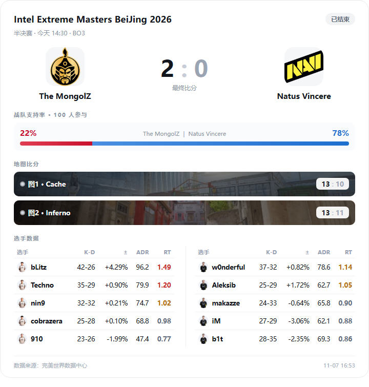
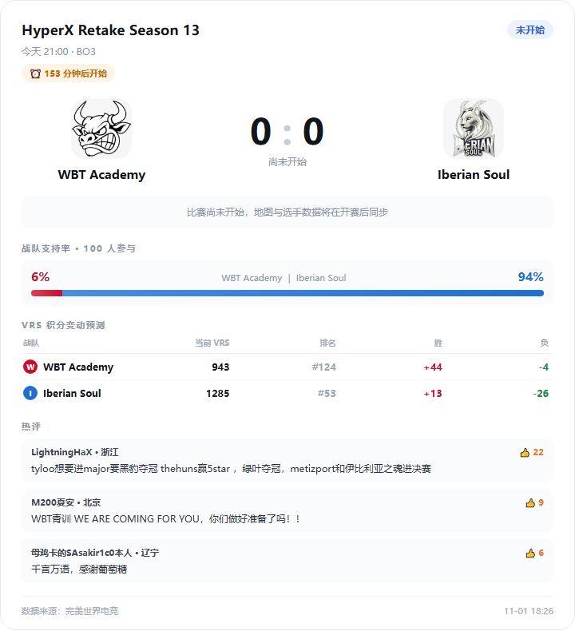

# CS 赛事助手（AstrBot 插件）

> 查赛程、看比分、订阅队伍/赛事，开赛前和每场比赛结束时自动把数据卡推到群里。
> **不需要任何 API Key**，数据来自公开赛事接口。

<p align="center">
  
  
</p>

<p align="center"><sub>左：整场总数据卡　·　右：赛前预告卡</sub></p>

---

## 它能做什么

| 能力 | 说明 |
| --- | --- |
| 赛事查询 | 按天查赛程、按队伍查比分、查看单场完整数据卡 |
| 数据卡 | 队徽、逐图比分（带地图背景）、双方 5v5 选手 K-D / ADR / Rating |
| 战队支持率 | 双方支持比例与参与人数 |
| VRS 积分 | 当前 VRS 分、全球排名，以及胜/负分别会加减多少分 |
| 热门评论 | 该场比赛的高赞评论，按点赞排序 |
| 订阅推送 | 订阅队伍或赛事后，自动推送赛前预告、每张图结束、整场结束 |
| 多群隔离 | 各群/会话订阅互不影响，只推自己订阅的比赛 |

订阅后你会收到**三种图片卡片**：

| 时机 | 卡片内容 |
| --- | --- |
| 开赛前 15 分钟 | 赛前预告：对阵、倒计时、支持率、VRS、热评 |
| 每张图结束 | 单图卡：该图比分 + **这一张图**的选手数据 |
| 整场结束 | 总数据卡：全部地图 + 整场 5v5 + 支持率 |

---

## 安装

### 方式一：下载压缩包（推荐）

1. 在本仓库 [Releases](https://github.com/shumatusu/astrbot_plugin_csgo_match/releases) 下载 `astrbot_plugin_csgo_match.zip`
2. 解压到 AstrBot 的插件目录，例如 `AstrBot/data/plugins/astrbot_plugin_csgo_match/`
3. 重启 AstrBot（或在 WebUI 里重载插件）
4. 发一条 `/csgo 帮助` 确认插件已加载

### 方式二：git clone

```bash
cd AstrBot/data/plugins
git clone https://github.com/shumatusu/astrbot_plugin_csgo_match.git astrbot_plugin_csgo_match
```

然后重启 AstrBot。

**环境要求**：AstrBot v3.x+、Python 3.10+。依赖 `httpx`、`jinja2` 写在 `requirements.txt` 里，插件管理器会自动安装。

> 地图背景图已经内置在 `assets/maps/`，渲染不依赖外部图床。

---

## 三分钟上手

```
/csgo 赛程                 ← 看看今天有什么比赛
/csgo 赛事订阅 IEM         ← 订阅 IEM 赛事
/csgo 队伍订阅 FaZe        ← 订阅一支队伍
/csgo 详情 2400008         ← 查看某场的完整数据卡
```

订阅赛事时，插件会立刻告诉你近期匹配到了哪些具体赛事，例如：

```
✅ 已为本群订阅赛事关键词：`iem`
📌 近期匹配到的赛事：Intel Extreme Masters BeiJing 2026
以上赛事的后续动态将推送到本会话。
```

---

## 指令一览

| 指令 | 说明 |
| --- | --- |
| `/csgo 赛程 [今天\|明天\|日期]` | 赛事列表，带比分与状态 |
| `/csgo 详情 <比赛ID>` | 高保真数据卡 |
| `/csgo 比分 <队伍>` | 查某支队伍相关比赛 |
| `/csgo 评论 <比赛ID> [条数]` | 热评，按点赞降序，默认 5 条、最多 20 条 |
| `/csgo 队伍订阅 <队伍>` | 支持缩写与别名（Faze、小蜜蜂、LVG） |
| `/csgo 赛事订阅 <赛事>` | 支持带空格全名、简称与语义匹配 |
| `/csgo 队伍取消 <队伍>` / `/csgo 赛事取消 <赛事>` | 取消订阅 |
| `/csgo 我的订阅` | 查看本会话订阅（赛事显示匹配到的全名） |
| `/csgo 数据源 [auto\|5eplay\|wanmei_data\|wmpvp]` | 查看 / 切换本群数据源 |
| `/csgo 诊断` | 排查「不推送」「没有图」的原因 |
| `/csgo 测试 渲染` | 一次渲染赛前 / 逐图 / 总数据全部卡片 |

不带参数发 `/csgo` 会显示完整帮助。

---

## 配置项（AstrBot WebUI → 插件配置）

常用项：

| 配置 | 默认 | 说明 |
| --- | --- | --- |
| `data_source` | `auto` | 默认数据源。`auto` 会按 5EPlay → 完美世界数据中心 → 完美电竞网关自动回退；指定具体源时失败直接报错，不静默切换 |
| `poll_enable` | `true` | 后台推送总开关 |
| `push_preview` | `true` | 是否推赛前预告 |
| `preview_minutes` | `15` | 提前多少分钟推预告 |
| `push_map_start` / `push_map_end` / `push_match_end` | `true` | 图开赛 / 图结束 / 整场结束推送开关 |
| `llm_provider_id` | 空 | 赛事订阅语义匹配用的 LLM。留空则用 AstrBot 当前对话模型 |
| `max_subs_per_session` | `10` | 每个会话最多订阅几条 |
| `interval_live` / `interval_today` / `interval_idle` | `60` / `300` / `600` | 有直播 / 今日有赛 / 空闲时的轮询间隔（秒） |
| `interval_night` + `night_start_hour` / `night_end_hour` | `1800` / `1` / `8` | 夜间免打扰时段与间隔 |

接口地址、渲染实现、调试开关等**开发者向配置已从 WebUI 隐藏**，默认值即可正常工作。

**LLM 是可选的**：赛事名先用字符串匹配，匹配不到才会调用 LLM 做语义兜底（3 秒超时、失败静默跳过）。不配 LLM 不影响其他功能。

---

## 常见问题

### 订阅了却收不到推送

先发 `/csgo 诊断`，它会一次性列出：轮询是否在跑、上次取到几场、订阅命中几场、**每条订阅各命中几场**、渲染是否可用、下一轮间隔。命中 0 时还会给出最接近的队名/赛事名。

常见原因：

- **订阅关键词没对上赛程**：同一赛事在不同数据源名字不同，比如 5EPlay 叫 `IEM 北京 2026`，完美系叫 `Intel Extreme Masters BeiJing 2026`。用诊断里的「近似」结果重新订阅即可。
- **订阅的队伍今天没有比赛**：这是正常的，等它有比赛就会推。
- **没有任何订阅**：后台不会推送任何比赛。

### 只有文字、没有图片

图片渲染有四级兜底：`AstrBot html_render` → `Playwright` → 本机 `Chrome/Edge` → 纯文字。

发 `/csgo 诊断 渲染` 可以实测一次，诊断里的「上次渲染」会写明每一级的实际结果。
如果前三级都不可用，可以在插件配置文件里手动加一行 `chrome_path` 指向浏览器可执行文件（这是高级项，没有放进 WebUI 面板）。

### 支持率 / VRS / 热评有时不显示

- 这些数据只有完美电竞网关提供，其他数据源下会省略相应区块
- **VRS 只在比赛未结束时展示**：比赛打完后「胜/负加减分」已无意义
- 刚结束的比赛可能还没有评论，属于正常

### 比赛临时改时间 / 提前开打

插件会处理：提前开打会在开赛后补推一张「已开赛」卡；单舞台赛事里前一场没打完时，后面场次最多暂缓 30 分钟就会照常推预告。

---

## 数据来源

- 5EPlay 赛事中心
- 完美世界数据中心
- 完美电竞网关（`gwapi.pwesports.cn`）

均为公开接口，无需鉴权。数据仅供个人学习使用，请尊重来源站点的服务条款，避免高频请求。

---

## 开发者文档

接口逆向、字段映射、多源调度、渲染降级与排障细节，见 [docs/DEVELOPMENT.md](docs/DEVELOPMENT.md)。

全链路自测（含真实接口）：

```bash
python tests/smoke_test.py
```

---

## 作者与仓库

- 作者：**shumatusu**
- 仓库： https://github.com/shumatusu/astrbot_plugin_csgo_match

欢迎提 Issue 反馈赛事数据源变化或命名匹配问题。
